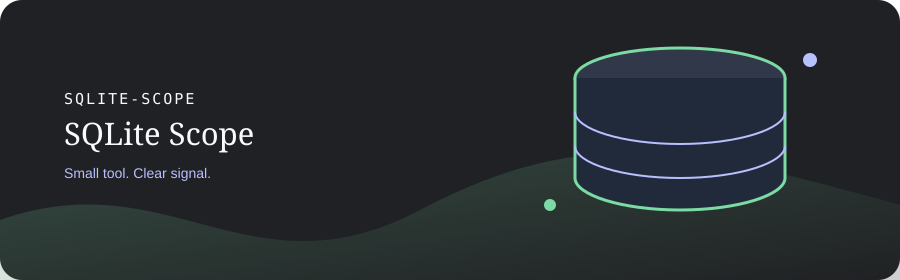

<div align="center">



# SQLite Scope

**A read-only schema and table-size explorer built on Python sqlite3.**

[](https://www.python.org/) [](LICENSE)

</div>

## Why it exists

See what lives inside a SQLite database without changing it. Opens the database in SQLite read-only mode and reports table names, columns and row counts. It does not dump row contents or execute user-supplied SQL.

## Features

- Read-only database connection
- Table and column metadata
- Row counts per table
- JSON output for scripts and CI

## Quick start

Python 3.10+; no third-party packages.

```bash
git clone https://github.com/MofidChallenge10/sqlite-scope.git
cd sqlite-scope
python tool.py --help
```

### Example

```bash
python tool.py app.db --json
```

## Self-test

```bash
python tool.py --self-test
```

The self-test uses the standard-library `unittest` module and does not contact external services.

## Scope and safety

Opens the database in SQLite read-only mode and reports table names, columns and row counts. It does not dump row contents or execute user-supplied SQL. Review output before using it in production workflows.

## Design notes

The illustration is an original lightweight SVG. Its motion is decorative only and respects `prefers-reduced-motion`; the CLI itself stays plain and pipe-friendly.

## Contributing

Issues and pull requests are welcome. Keep the standard-library-first approach, add focused tests for behavior changes, and update examples when options change.

## License

MIT — see [LICENSE](LICENSE).
